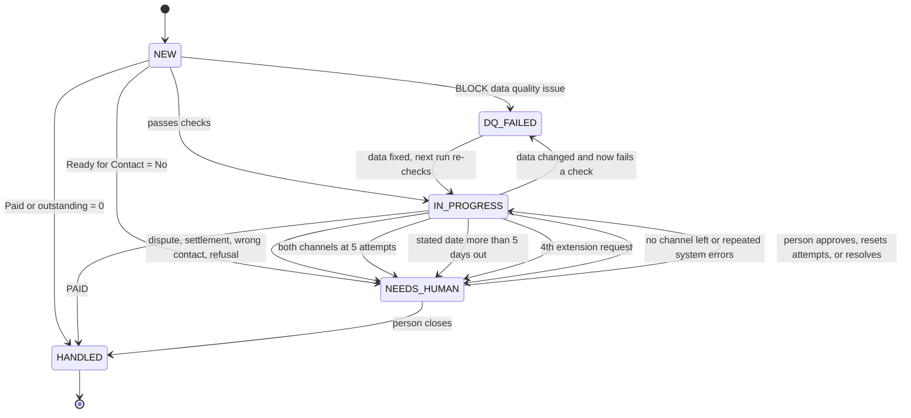
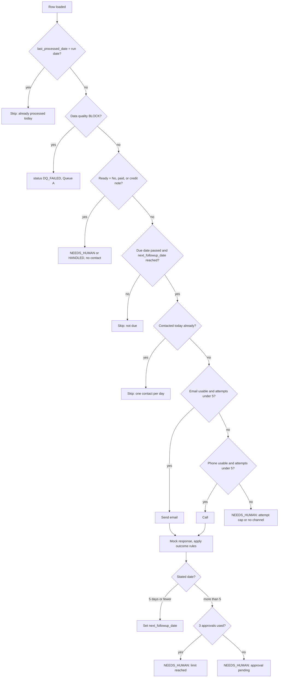

# Invoice Follow-Up Assistant: Design Specification

Status: final, as built and reviewed (see docs/REVIEW.md). Source data: `Case Study Data – Overdue Invoices (Head of Automation) - Untitled.csv` (35 rows, 18 columns). The Google Sheet is the only data store.

## 1. Purpose and scope

Follow up with contacts on overdue invoices, record every attempt, and get the invoice paid. A row that is paid, or no longer needs follow-up, is *handled*. Anything the app cannot or should not handle goes to a person.

In scope: row-by-row data quality checks, email-then-phone follow-up with mocked responses, a human queue, a Plotly dashboard, an About page with the business rules, Streamlit Community Cloud deployment.
Out of scope: sending real email or placing real calls, currency conversion, a database other than the sheet.

## 2. Data model

### 2.1 Existing columns (kept as is, never renamed or reordered)

| Column | Type | How the app uses it |
|---|---|---|
| Invoice Number | text, key part | Identity; duplicates detected on it. Prefix `INV-` = invoice, `CN-` = credit note. |
| Customer | text | Display, search, contact key fallback. |
| Country | AT, CZ, DE, HU, RO | Dashboard "contact location" filter; default dial code. |
| Contact Name | text | Salutation in mock responses; contact key fallback. |
| Email | text, nullable | Validated; drives `can_contact_email`. |
| Phone | text, nullable | Normalised to E.164; drives `can_contact_phone`. |
| Invoice Date, Due Date | date `yyyy-mm-dd` | Overdue test (Due Date <= run date). |
| Invoice Amount | decimal | Original amount. |
| Amount Outstanding | decimal | Open balance. 0 = paid. Reduced by a partial payment, set to 0 by PAID (mock mode only). |
| Currency | EUR, CZK, HUF, RON | Never summed across currencies. |
| Last Contact Date | date, nullable | Written on every contact attempt. |
| Contact Attempts | integer | Kept as `email_attempts + phone_attempts + legacy_attempts` so the original column stays meaningful. |
| Ready for Contact | Yes / No / blank | Human hard stop when No. Blank = not evaluated; the app derives Yes/No and writes it back. |
| Outcome | outcome code | Latest outcome code (section 3). |
| Summary | text | Latest response summary (one line). |
| Last Updated | `yyyy-mm-dd H:MM` | Written on every app update. Parsed tolerantly (hour may lack a leading zero). |
| Notes | text | Human notes only. **The app never writes to it.** |

### 2.2 New columns appended to the Invoices sheet

| Column | Type | Meaning |
|---|---|---|
| row_key | text | `<Invoice Number>#<n>`, n = occurrence order (the second INV-2026-4471 is `#2`). Stable identifier for writes. |
| contact_key | text | Email, else phone, else `Contact Name + Customer` (lower-cased). One contact can own many rows. |
| email_attempts, phone_attempts | int | Attempts that count towards the cap (section 5). |
| legacy_attempts | int | Migrated attempts whose channel is unknown. |
| email_responses, phone_responses | int | Attempts that got a real response (Contact made category). |
| last_channel | email / phone | Channel of the most recent attempt. |
| next_followup_date | date | Earliest date the row may be contacted again. Blank = due now. |
| last_promised_date | date | Date the contact last stated (payment or callback). |
| status | enum | NEW, IN_PROGRESS, NEEDS_HUMAN, DQ_FAILED, HANDLED. One value per row. |
| dq_status | PASS / WARN / FAIL | Result of the data quality rules. |
| dq_issues | text | Semicolon-separated `RULE:CODE`. |
| can_contact_email, can_contact_phone | Yes / No | Whether the stored address or number is valid. Recomputed every day. A bounce is remembered separately in `email_disabled` / `phone_disabled`. |
| human_flag | Yes / blank | Set while status is NEEDS_HUMAN or DQ_FAILED. |
| human_reason | code | Reason (section 3.3). |
| approval_status | NONE / PENDING / APPROVED / REJECTED | State of the latest extension request. |
| pending_approval_date | date | Date awaiting approval. |
| extension_approvals_count | int | Approvals granted to this contact (max 3). |
| consecutive_system_errors | int | Resets on any non-system outcome. |
| last_processed_date | date | Run date on which this row was last decided. Drives idempotency. |
| human_resolution_note | text | Note a person records when resolving. Separate from Notes. |
| email_disabled, phone_disabled | Yes / blank | Set when a bounce, invalid address or dead number switched the channel off. Kept apart from `can_contact_*` (which the data quality check recomputes daily) so a bounce is never overwritten. A person re-enables a channel when resolving the row. |

Counters that belong to a contact (attempts per channel, approvals, system errors) are replicated onto each of that contact's open rows and updated together. The engine reads the maximum across the contact's open rows.

### 2.3 Additional worksheets

**Audit_Log** (append only): `event_id`, `run_id`, `timestamp`, `run_date`, `row_key`, `contact_key`, `contact_event_id` (shared when one contact event covers several rows), `channel`, `attempt_no_for_channel`, `counted_as_attempt`, `outcome`, `response_text`, `promised_date`, `status_before`, `status_after`, `human_reason`, `actor` (`system` or a user name for human actions).

**Run_Log**: `run_id`, `run_date`, `started_at`, `finished_at`, `state` (RUNNING / DONE / FAILED), `rows_total`, `rows_processed`, `rows_skipped_already_processed`, `rows_skipped_not_due`, `rows_dq_failed`, `rows_escalated`, `attempts_email`, `attempts_phone`, `errors` (JSON list of row_key + message, with secrets removed), `started_by` (who pressed Run, or `system`).

**Config** (key / value, editable in the sheet): `attempt_cap=5`, `promise_max_days=5`, `max_approvals=3`, `default_retry_days=2`, `system_error_limit=3`, `invoice_prefix=INV-`, `timezone=Europe/Berlin`, `min_amount_EUR=10`, `min_amount_CZK=250`, `min_amount_HUF=4000`, `min_amount_RON=50`, `skip_below_minimum=false`, `legacy_migration_done=false`.

## 3. Outcome taxonomy

Existing sheet values are kept. Codes marked NEW are added. "Counts" = consumes one attempt towards the cap of 5. "Real" = counts as a real response (resets nothing, but means contact was made).

### 3.1 Contact made (Real = yes, Counts = yes)

| Code | Meaning | Resulting status and next action |
|---|---|---|
| PAID | Paid in full | HANDLED. Amount Outstanding set to 0. |
| PARTIAL_PAYMENT | Part paid | IN_PROGRESS. Outstanding reduced. Follow up per stated date, else default retry. |
| PROMISE_TO_PAY | States a payment date | IN_PROGRESS. Date rule BR-09 to BR-11. |
| PAYMENT_IN_PROCESS (NEW) | Payment already initiated | IN_PROGRESS. Follow up in 3 days to confirm. |
| CALLBACK_REQUESTED | Asked to be called at a given time | IN_PROGRESS. Next channel phone. Date rule applies. |
| REQUESTS_INVOICE_COPY (NEW) | Needs the invoice again | IN_PROGRESS. Copy is logged as sent; follow up in 2 days. |
| SETTLEMENT_REQUESTED | Asks for an instalment plan | NEEDS_HUMAN (SETTLEMENT). |
| DISPUTE | Disputes the invoice | NEEDS_HUMAN (DISPUTE). |
| WRONG_CONTACT | Not the right person | NEEDS_HUMAN (WRONG_CONTACT). Channel disabled until a human updates the contact. |
| REFUSED_TO_PAY (NEW) | Explicit refusal | NEEDS_HUMAN (REFUSED). |

### 3.2 No contact and channel or system errors

| Code | Counts | Real | Effect |
|---|---|---|---|
| NO_RESPONSE (NEW, email) | yes | no | Retry after `default_retry_days`. |
| NO_ANSWER (phone) | yes | no | Retry after `default_retry_days`. |
| LEFT_VOICEMAIL (NEW) | yes | no | Same as NO_ANSWER. |
| OUT_OF_OFFICE | yes | no | Next follow-up = return date. Exempt from approval and from the 3-approval cap (assumption A-04). |
| EMAIL_BOUNCE_SOFT (NEW) | yes | no | Retry next run date. |
| EMAIL_BOUNCE_HARD (NEW) | yes | no | `can_contact_email = No`. Switch to phone. |
| EMAIL_INVALID_ADDRESS (NEW) | yes | no | `can_contact_email = No`. |
| PHONE_LINE_BUSY (NEW) | yes | no | Retry next run date. |
| PHONE_INVALID_NUMBER (NEW) | yes | no | `can_contact_phone = No`. |
| PHONE_DISCONNECTED (NEW) | yes | no | `can_contact_phone = No`. |
| EMAIL_SEND_FAILURE (NEW) | **no** | no | Our side failed. Retry next run date. Counts towards `system_error_limit`. |
| PHONE_SYSTEM_ERROR (NEW) | **no** | no | As above. |
| SYSTEM_ERROR (NEW) | **no** | no | As above (unexpected exception in a row). |

Both channels disabled, or `system_error_limit` consecutive system errors, escalates to NEEDS_HUMAN.

### 3.3 Escalation and human reasons

`Outcome` is set to one of these only when the app itself escalates without a contact event: `NEEDS_HUMAN_FOLLOW_UP`, `MAX_ATTEMPTS_REACHED`, `DQ_FAILED`. The granular reason always goes in `human_reason`:

`DQ`, `READY_NO`, `ATTEMPT_CAP`, `ATTEMPT_CAP_LEGACY`, `NO_CHANNEL_LEFT`, `EXTENSION_APPROVAL_PENDING`, `EXTENSION_LIMIT_REACHED`, `DISPUTE`, `SETTLEMENT`, `WRONG_CONTACT`, `REFUSED`, `SYSTEM_ERRORS_REPEATED`, `NOT_AN_INVOICE`.

## 4. Row lifecycle

Precedence when several conditions are true: `DQ_FAILED` > `HANDLED` > `NEEDS_HUMAN` > `IN_PROGRESS`. `status` holds exactly one value, so the four dashboard buckets cannot overlap. NEW rows and rows waiting for a future follow-up date count as IN_PROGRESS on the dashboard.

Daily decision flow for one contact:

## 5. Business rules

| ID | Rule | Example from the data |
|---|---|---|
| BR-01 | A row is eligible for contact only if status is IN_PROGRESS, Amount Outstanding > 0, Due Date <= run date, and next_followup_date is blank or <= run date. | INV-2026-4512 (due 2026-08-29) is not contacted on a run date before that. |
| BR-02 | Start with email whenever `can_contact_email = Yes` and email attempts < 5. Email is cheaper. | INV-2026-4402 was called once; its next attempt is still email. |
| BR-03 | Hard cap: at most 5 counted attempts per channel per contact. | |
| BR-04 | When email attempts reach 5 (or email is disabled), switch to phone. | INV-2026-4301 has no email, so it starts on phone. |
| BR-05 | When both channels are exhausted or disabled, status becomes NEEDS_HUMAN (`ATTEMPT_CAP` or `NO_CHANNEL_LEFT`). The outcome is `MAX_ATTEMPTS_REACHED` for a used-up cap and `NEEDS_HUMAN_FOLLOW_UP` when no channel is left (A-11). If an unanswered attempt uses up the last channel, this happens at once. | |
| BR-06 | Never contact the same contact twice on one calendar day (timezone from Config). A contact with several open invoices gets one combined contact covering all of them. | Veltner Gastro: three invoices, one contact per day. |
| BR-07 | The daily run is idempotent: a row whose `last_processed_date` equals the run date is skipped. A row is stamped once a decision (contact, skip, escalate, DQ result) is recorded for it. | Run twice on one day: second run changes nothing. |
| BR-08 | "Real response" = any outcome in the Contact made category. OUT_OF_OFFICE, voicemail and errors are not real responses. | |
| BR-09 | If the contact states a date 5 days or fewer from the run date, set `next_followup_date` to it. | |
| BR-10 | If the stated date is more than 5 days away, set status NEEDS_HUMAN (`EXTENSION_APPROVAL_PENDING`), `approval_status = PENDING`, and do not contact until a person decides. Approve: `next_followup_date` = stated date, approvals +1. Reject: stays NEEDS_HUMAN. | INV-2026-4233 promised 31 Aug after contact on 18 Aug (13 days). |
| BR-11 | A contact may receive at most 3 approvals. A further request becomes NEEDS_HUMAN (`EXTENSION_LIMIT_REACHED`) with no approval offered. | |
| BR-12 | With no stated date, retry after `default_retry_days` (2). | |
| BR-13 | EMAIL_BOUNCE_HARD and EMAIL_INVALID_ADDRESS disable email. PHONE_INVALID_NUMBER and PHONE_DISCONNECTED disable phone. | |
| BR-14 | Our-side failures (EMAIL_SEND_FAILURE, PHONE_SYSTEM_ERROR, SYSTEM_ERROR) do not consume an attempt. Three in a row set NEEDS_HUMAN (`SYSTEM_ERRORS_REPEATED`). | |
| BR-15 | PAID sets Amount Outstanding to 0 and status HANDLED. PARTIAL_PAYMENT reduces the balance and keeps IN_PROGRESS. | INV-2026-4199: 1,225 RON left of 9,800. |
| BR-16 | DISPUTE, SETTLEMENT_REQUESTED, WRONG_CONTACT and REFUSED_TO_PAY set NEEDS_HUMAN with the matching reason. | INV-2026-4177 (dispute). |
| BR-17 | Ready for Contact = No: status NEEDS_HUMAN (`READY_NO`), never contacted, Notes text shown as the reason. | INV-2026-3980 (insolvency), INV-2026-4415 (on hold). |
| BR-18 | Data quality BLOCK rows are status DQ_FAILED (`DQ`), shown in Queue A, never contacted, re-checked each day. | Duplicate INV-2026-4471, credit note CN-2026-0118, INV-2026-4144 (no channel). |
| BR-19 | One-time migration of legacy history: a Summary saying the contact was called (but not "called back") assigns attempts to phone, one mentioning email, an auto-reply or a reply assigns them to email, anything else (or both) goes to `legacy_attempts`. `legacy_attempts` of 5 or more sets NEEDS_HUMAN (`ATTEMPT_CAP_LEGACY`). Dates found in Summary seed `last_promised_date` and `next_followup_date`; legacy promises are honoured and are not counted as approvals (A-03). | INV-2026-3902 (5 legacy attempts) goes to a human. |
| BR-20 | Credit notes (prefix not `INV-` or negative outstanding) are never contacted (`NOT_AN_INVOICE`, DQ_FAILED). | CN-2026-0118. |
| BR-21 | Human actions (approve, reject, reset attempts, mark resolved, close) are written to Audit_Log with the user's name and to `human_resolution_note`. Notes is never overwritten. | |
| BR-22 | Every attempt and every status change is appended to Audit_Log. Every run writes one Run_Log row. | |
| BR-23 | Amounts are reported per currency and never added across currencies. | |
| BR-24 | Only one run per run date may be RUNNING at a time (lock in Run_Log). A run logs its own row and then checks it is the earliest active one, so two people pressing Run together cannot both run. People cannot approve or resolve while any run is going. A RUNNING row older than 30 minutes is treated as crashed. | |
| BR-25 | A human decision can be made in the app or by editing the sheet, with the same result. One promise covering several invoices is decided **once per contact** and uses one approval. To decide in the sheet, set `approval_status` to APPROVED or REJECTED on any row that is NEEDS_HUMAN with reason EXTENSION_APPROVAL_PENDING (optionally edit `pending_approval_date` first); every row waiting on that date follows. A reconcile step runs at the start of every run and whenever the Human Queue refreshes, finishes the hand edit, and logs it with actor "sheet edit". Conflicting edits (one APPROVED, one REJECTED) change nothing and are shown as an issue. An approval beyond the cap is refused. | Veltner Gastro: three rows pending on one promise, one approval used. |
| BR-26 | Every row is in exactly one of four groups: in progress, needing human follow-up, data quality failed, handled. The groups always add up to the number of rows; the Run page and the Dashboard both check it and say so when they do not. A row with an unrecognised status is reported, never silently counted. | 35 rows: 3 + 1 + 6 + 25 before the first contact. |
| BR-27 | A run cannot be dated earlier than rows that were already processed. The Run page disables the button with an explanation, and the runner refuses and logs the attempt as FAILED. Running the same date again is a harmless no-op. | Rows processed on 25 Aug: a run dated 21 Aug is refused. |

### Baseline on the real file (before the first run)

| Bucket | Rows | Invoices |
|---|---|---|
| DQ_FAILED | 3 | second INV-2026-4471, CN-2026-0118, INV-2026-4144 |
| HANDLED | 1 | INV-2026-4265 |
| NEEDS_HUMAN | 6 | 4177 (dispute), 3980 (no contact), 3902 (legacy cap), 4415 (hold), 4029 (wrong contact), 3955 (settlement) |
| IN_PROGRESS | 25 | all others |
| **Total** | **35** | 3 + 1 + 6 + 25 |

## 6. Dashboard specification

KPIs (all respect the filters below):
- **Total attempts**: counted attempts in Audit_Log (system errors shown separately).
- **Response rate** = attempts with a real response / counted attempts.
- **Success rate** = attempts leading to PAID, PARTIAL_PAYMENT, PROMISE_TO_PAY or PAYMENT_IN_PROCESS / counted attempts.
- **Failure rate** = No contact outcomes + vendor-side channel errors / counted attempts.
- **System error rate** = system errors / all attempts including system errors.
- **Human escalation rate** = rows with NEEDS_HUMAN or DQ_FAILED / total rows.

Row counts: `DQ_FAILED + NEEDS_HUMAN + IN_PROGRESS + HANDLED = total rows`. The page asserts this and shows a visible warning if it fails.

Filters: Country (the contact location), text search on Customer, Contact Name, Email, Invoice Number.
Charts (Plotly): attempts per day by channel, outcome mix coloured by category, response / success / failure rate for email and phone, success rate by country. Outstanding amounts per currency are a table (never added across currencies). Every chart has a table view.
Drill-down: choose a contact; table of every attempt (date, channel, attempt number, outcome, response text), the approvals used, and recurring themes from response text (keyword frequency, no external API).

## 7. Pages

1. **Run**: run date (defaults to today; a simulated date allows testing across days), "Run follow-ups" button, progress, result summary, data quality summary, count of rows skipped as already processed.
2. **Human Queue**: Section A "Data quality failures" (red) and Section B "Needing human follow-up" (amber, grouped by reason), plus a pending extension approvals list with Approve / Reject and an attempts reset action. Sections never mix.
3. **Dashboard**: as in section 6.
4. **About**: purpose, architecture, data model, taxonomy, the Business Rules section (generated from the same catalog the engine uses), assumptions, limitations.

## 8. Architecture summary

Streamlit pages (`app.py`, `pages/`, with shared helpers in `app_common.py`) call `core/`, which has no Streamlit imports: `schema`, `sheets`, `quality`, `taxonomy`, `mock_responses`, `rules`, `runner`, `actions`, `queue`, `metrics`, `charts`, `clock`, `redact`, `rules_catalog`. `sheets` is the only module that talks to Google (gspread, service account in `st.secrets`). Streamlit Community Cloud has no persistent disk, which matches the sheet-only design.

## 9. Assumptions and open questions

| ID | Assumption | Status |
|---|---|---|
| A-01 | Ready for Contact = No counts as Needing human follow-up; blank is derived. | Decided |
| A-02 | One combined contact per day per contact across their invoices. | Decided |
| A-03 | Legacy promises are honoured, not retroactively sent for approval (INV-2026-4233 and similar). | Confirmed |
| A-04 | OUT_OF_OFFICE return dates are exempt from approval and do not use up the 3 approvals. | Confirmed |
| A-05 | System-side failures do not consume an attempt. | Assumed |
| A-06 | The default retry gap is 2 days; minimum-amount thresholds are placeholders in Config. | Placeholder |
| A-07 | In mock mode the app writes Amount Outstanding on PAID and PARTIAL_PAYMENT. In production the balance would come from the ERP. | Assumed |
| A-08 | Mock responses are in English; German, Czech, Hungarian or Romanian text is not required. | Assumed |
| A-09 | Existing outcomes DISPUTE, SETTLEMENT_REQUESTED and WRONG_CONTACT migrate to NEEDS_HUMAN. | Confirmed |
| A-10 | The deployed app is protected by `app_password` in the secrets (and, if possible, restricted to named viewers in Streamlit's sharing settings); the sheet is shared only with the service account. | Recommended |
| A-11 | A row with no channel left gets the outcome NEEDS_HUMAN_FOLLOW_UP; only a used-up attempt cap gets MAX_ATTEMPTS_REACHED. | Confirmed |
| A-12 | A person's approval or resolution does not clear the row's processed date: the row resumes on its next follow-up date. | Confirmed |
| A-13 | A rejected extension keeps the row with a person, marked REJECTED, reason code unchanged. | Confirmed |
| A-14 | With the skip-small-amounts setting on, those rows stay in progress and are never contacted. | Confirmed |

Still open: the real minimum-amount thresholds (placeholders in Config), and whether the Notes column should ever be machine-readable (today it never is).
